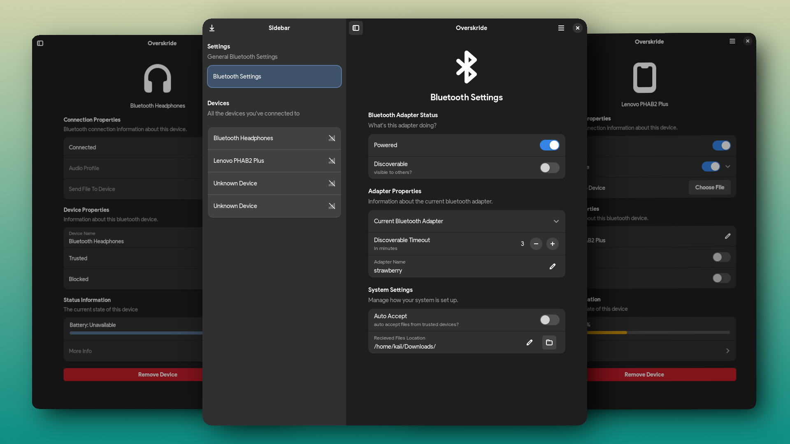

# Bindrune
A Bluetooth and Obex client that is straight to the point, DE/WM agnostic, and beautiful :D

Bindrune is a hard fork of [Overskride](https://github.com/kaii-lb/overskride) by kaii. The name refers to the Bluetooth logo, which is a bindrune of the runes ᚼ and ᛒ.



# Installing

Bindrune talks to BlueZ, so the Bluetooth service has to run:

```bash
sudo systemctl enable --now bluetooth
```

File transfers also need `obexd` (often packaged as `bluez-obex`).

- **Flatpak:** build it yourself, see [Flatpak](#flatpak) below.
- **Nix:** `nix run git+https://codeberg.org/wvhulle/bindrune`, or add the flake's `overlays.default` to your system.
- **From source:** see below.

# Running in the background

Closing the window keeps Bindrune running, so phones can still pair and send files. A tray icon (on desktops with StatusNotifierItem support, e.g. KDE, or GNOME with the AppIndicator extension) reopens the window. Pairing requests and incoming files show a notification while the window is hidden or unfocused. Quit from the main menu, the tray icon or with Ctrl+Q. Both behaviours can be switched off under Settings → Background.

To start hidden at login, either turn on *Start at Login* in the settings, or run Bindrune as a systemd user service:

- **home-manager:** import `bindrune.homeManagerModules.default` and set `services.bindrune.enable = true;`
- **NixOS:** import `bindrune.nixosModules.default` and set `services.bindrune.enable = true;` (enabled for every graphical session)
- **Other distributions:** `make install` installs `lib/systemd/user/bindrune.service`; enable it with `systemctl --user enable --now bindrune`

The service runs `bindrune --background`. Launching Bindrune from the app menu opens the window of that running instance.

# Building

## Prerequisites

- Rust, preferably through [rustup](https://rustup.rs), which picks up `rust-toolchain.toml`
- Development packages for GTK 4 (≥ 4.16), libadwaita (≥ 1.6), D-Bus and PulseAudio (libpulse)
- `glib-compile-schemas` (part of GLib)

On Nix, `nix develop` (or `direnv allow`) provides all of these.

## Running from the checkout

```bash
cargo run -p bindrune-gtk
```

No installation is needed: the build compiles the GSettings schema and the app uses it when no installed schema is found.

## Formatting

Formatting uses nightly rustfmt (imports grouped by crate). Run `nix fmt`, or `cargo +nightly fmt` without Nix. `nix flake check` checks it.

## Installing

```bash
make
sudo make install            # PREFIX defaults to /usr/local
sudo make uninstall
```

`make install DESTDIR=… PREFIX=/usr` stages files for distribution packages. `make check` runs the tests and validates the desktop file, metainfo and schema.

## Flatpak

```bash
flatpak-builder --user --install --force-clean flatpak-build page.codeberg.wvhulle.Bindrune.json
```

# Features
- Dynamically enumerate and list all devices known/in range 
- Authenticating with devices (aka passkey confirmation)
- Sending/receiving files
- Connect/disconnect from devices
- Rename device
- Trust or block a device
- Remove device
- Turn adapter on/off
- Set discoverable and its timeout
- Selecting between multiple adapters
- Rename adapter 
- Resizing support 
- Sorting devices by rssi (signal strength) (connected and then trusted devices come first)
- Showing errors to user
- Changing files storage location
- Auto accept files
- Audio profiles
- Battery polling over bluetooth (enable experimental bluetooth options)
- Transfer rate for incoming/outgoing file transfers
- More info about device (with distance approximation)
- Running in the background with a tray icon and notifications

# What doesn't work
- Quality of life stuff (auto trust on pair, auto accept service)
