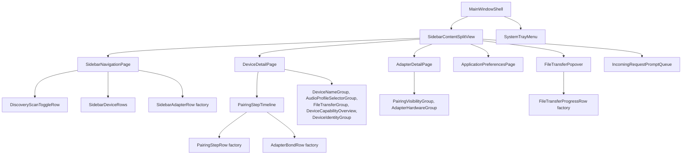

# Development

Setup and workflow for working on Bindrune. The rules the code follows are in
[style.md](style.md).

## Workspace

Work inside the Nix devshell (`nix develop`, or `direnv allow`). The
repository is a cargo workspace:

- `bindrune-bluez/` wraps BlueZ, obexd, udev and PulseAudio. It knows nothing
  about GTK and exposes snapshots, change streams and commands, grouped by
  BlueZ concept: `bluetooth_adapter/`, `remote_device/`, `device_pairing/`,
  `link_quality/`, `obex_file_transfer/`.
- `bindrune-gtk/` is the Relm4 application (binary `bindrune`), grouped by the
  region of the window each module draws: `sidebar_navigation/`,
  `device_detail/`, `adapter_detail/`, `header_transfer_popover/`,
  `incoming_request_prompts/`. `background_application_lifecycle/` holds what
  draws nothing on screen: the window shell, tray menu, stored preferences and
  login autostart.
- `bindrune-screenshot-showcase/` renders the README screenshots (binary
  `render-readme-screenshots`).

## Component tree



Each child owns its state and talks to its parent only through its `Input`
and `Output` messages.

## Building and checking

```bash
cargo run -p bindrune-gtk     # run from the checkout
cargo test --workspace
cargo clippy --workspace --all-targets
make check                    # tests plus desktop file, metainfo and schema validation
nix flake check               # tests, clippy, formatting and the NixOS service unit
```

Formatting uses nightly rustfmt, pinned in `flake.nix`, so imports are grouped
by crate. The build itself stays on the stable toolchain from
`rust-toolchain.toml`. Run `nix fmt` (treefmt with rustfmt and nixfmt), or
`cargo +nightly fmt` without Nix.

## CI

Woodpecker CI (`.woodpecker/checks.yaml`) builds the flake `checks` on pull
requests and on pushes to `main`: tests and clippy (through the `wvhulle`
Cachix cache on `main`), formatting, and the NixOS background service unit.
The screenshot pipeline is described under [Screenshots](#screenshots). On
pull requests it also checks the commits against Conventional Commits
(locally: `nix run --inputs-from . nixpkgs#convco -- check main..HEAD`).

## Screenshots

The README screenshots are rendered from the real application, not drawn by
hand. `bindrune-screenshot-showcase` starts two isolated D-Bus buses and serves
a fake BlueZ on the system bus with dbus-crossroads: one adapter and the
fixture devices in `fake_bluez_fixture_devices.rs`. It then runs headless sway
with the pixman renderer, launches `bindrune` for each screenshot (with
`--open-device=ADDRESS` to open a device page), and captures the window with
grim at scale 2.

```bash
nix run .#render-readme-screenshots -- screenshots   # renders into ./screenshots
nix build .#readme-screenshots                       # the same, inside the Nix sandbox
```

A run outside the sandbox can pick up the local adapter's udev hardware
description; the sandboxed build cannot, so it shows the adapter as `hci0`.

After the checks pass on `main`, the `.woodpecker/readme-screenshots.yaml`
pipeline renders them in the sandbox and force-pushes them as the single commit
of the orphan `screenshots` branch, which the README and the metainfo embed.
The push needs the `codeberg_token` secret.

